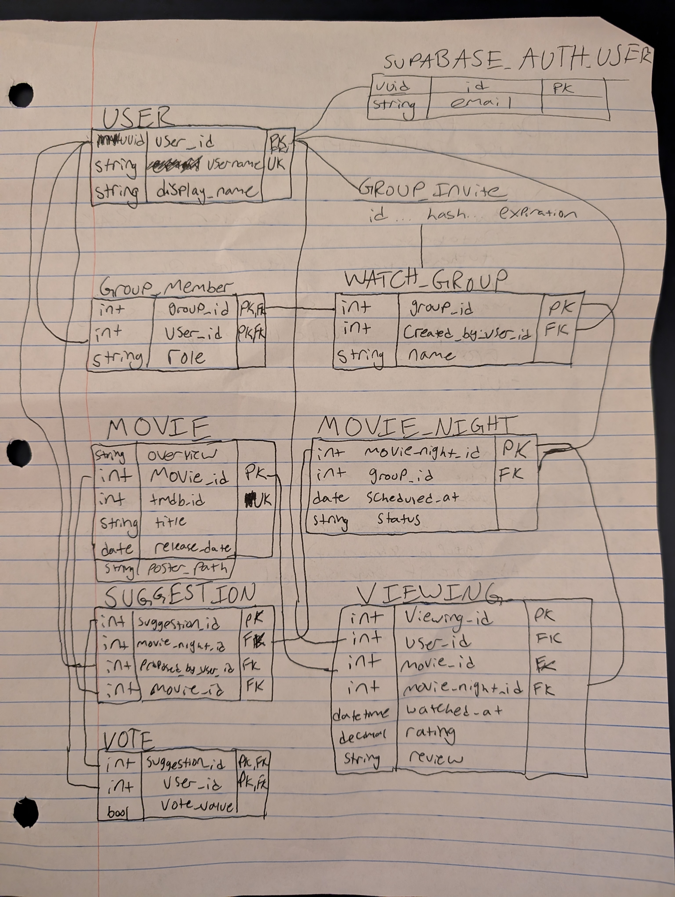
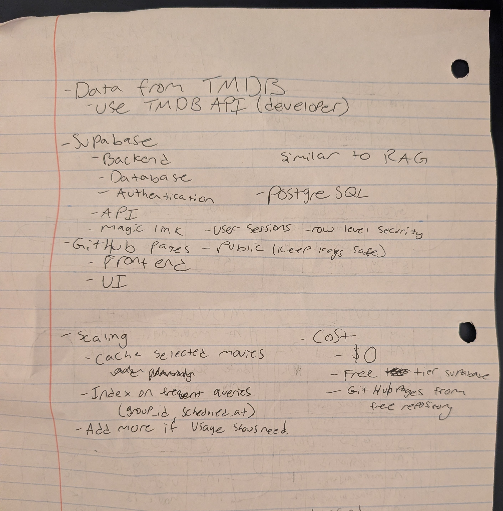

# Project Initial Design

## Project purpose and goals

I want to build an app that helps a group decide what to watch together and remember what they have watched. Members can create a private group, schedule a movie night, suggest movies, vote on suggestions, and record their own viewing history, ratings, and reviews.

TMDB will provide movie information. My app will save only movies selected by users, then connect those records to suggestions and viewings. This project will let me practice relational modeling, constraints, queries, authentication, and row-level security.

## ERD

## Technology to Use

## Curent Daily Goals

Work on the project everyday for at least an hour. Have a specific smaller goals for each day that I will decide upon starting to work on the project. Learn as much as possible along the way.
